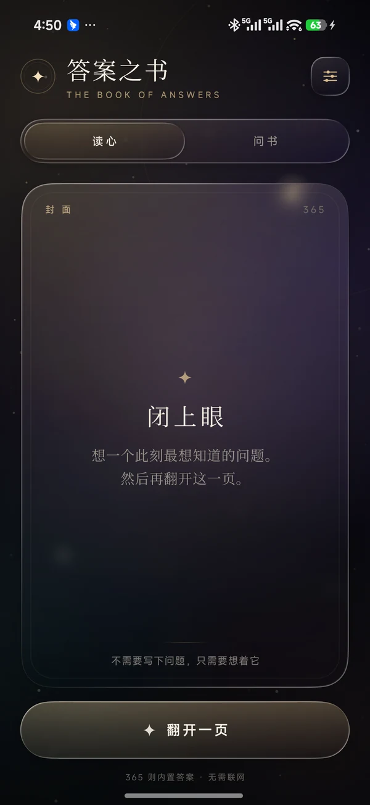
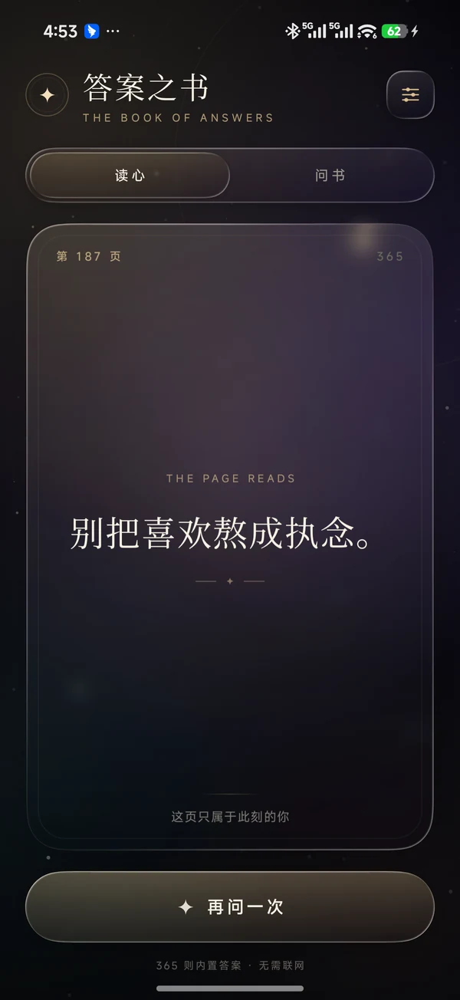
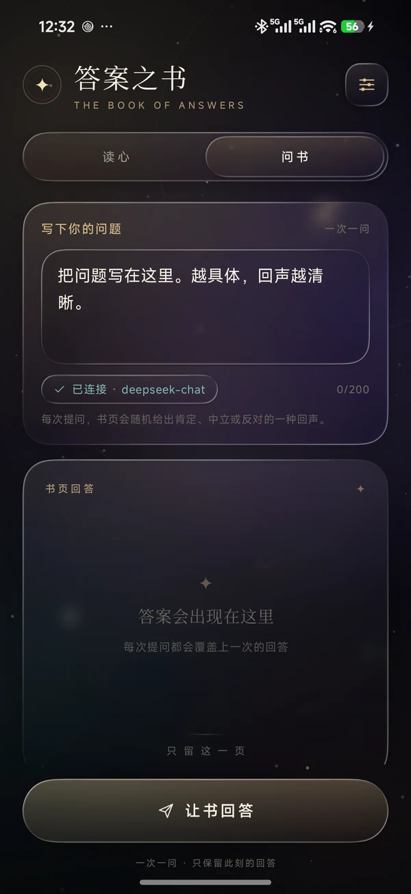
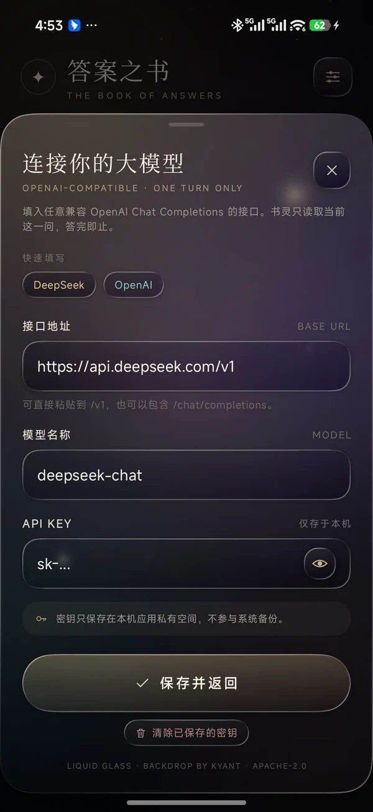

# 答案之书

一本会折射光的随身答案之书。Android 原生应用，使用 Kotlin + Jetpack Compose 编写，全部界面控件建立在 [Kyant 的 AndroidLiquidGlass / Backdrop](https://github.com/Kyant0/AndroidLiquidGlass) 液态玻璃效果之上。

本项目以 **Apache License 2.0** 开源发布。

| 读心 · 封面 | 读心 · 答案 |
| --- | --- |
|  |  |

| 问书 | 连接大模型 |
| --- | --- |
|  |  |

## 两个模式

### 读心
- 不需要输入问题，闭眼默念，点一次「翻开一页」。
- 内置 **365 则**离线答案，对应 365 页；随机抽取，并避免连续抽到同一页。
- 整个交互只有一个主按钮：翻开 / 再问一次。
- 答案会根据字数自动收缩字号，始终以一行书页文字呈现。

### 问书
- 填入自己的 OpenAI 兼容大模型接口（Base URL、模型名、API Key）。
- 每次只发送当前这一问，不保留任何历史对话；屏幕上永远只有一个当前回答。
- 回答被限制为一句简短、含蓄、略带模糊的箴言。
- 每次提问由 App 随机抽取 **肯定 / 中立 / 反对** 三种立场，避免永远只给正向回答。
- 生死、爱国、政治类问题强制进入安全正向通道，只给积极、关怀、建设性的回答。

## 随机立场与安全边界

### 洗牌袋

普通问题使用三档“洗牌袋”：

```
每轮 = [肯定, 中立, 反对] 洗牌后依次抽取
抽完再洗一轮；跨轮也不会让同一个立场连续出现
```

这样做的好处是：

- 单次提问仍有随机性；
- 连续提问不会一直得到肯定；
- 三种立场长期分布稳定，不会出现某一种特别稀缺。

抽到的立场只注入提示词，不显示在界面上，答案仍然保持《答案之书》的模糊感。

### 敏感问题保护

敏感问题分两层保护：

1. **本地关键词闸门**：`SafetyGuard` 在发请求前检查生死、自伤、爱国、政治、战争、领土、民族、宗教等关键词；命中后强制 `SAFE` 模式，不参与随机。
2. **提示词最高优先级**：所有提示词都包含安全规则，即使本地没有命中，模型识别到敏感语义时也必须忽略随机立场，返回正向、关怀、非对抗的回答。

“正向”在这里的定义：

- **生死 / 自伤**：珍惜生命，鼓励留在安全处、向身边人或当地紧急服务求助；不输出绝望、否定生命或鼓励伤害的内容。
- **爱国 / 政治**：积极、建设性、非对抗；不评价具体人物、事件、政策，不作预测，不输出争议或煽动性内容。

如果检测到自伤/自杀风险，答案下方会额外显示一行很小的求助提示。这是本地判断，不会增加模型调用。

## 检查更新

设置页的「应用更新」区域只有一个「检查更新」按钮；检查地址已内置，不需要填写仓库：

```text
Gitee:  muli520/answer-book   （优先）
GitHub: muli520/answer-book   （回退）
```

实现方式：

- 先请求 `https://gitee.com/api/v5/repos/muli520/answer-book/releases/latest`
- Gitee 5 秒内没有结果或没有 Release，自动回退：
  `https://api.github.com/repos/muli520/answer-book/releases/latest`
- 读取 Latest Release 的 `tag_name` 与 APK 资产；有 APK 时显示「下载 APK」，否则打开 Release 页面
- 版本比较使用数字段，例如 `v1.2.2` 与当前 `1.2.2`
- 只打开浏览器下载页，不自动下载、不自动安装
- 不需要 Token；公开仓库即可，GitHub 未登录接口有频率限制

检查结果只在当前设置页内展示，不会上传任何问题或 API Key。

## 大模型提示词

提示词位于 `app/src/main/java/com/answerbook/glass/data/LlmPrompt.kt`，由四套提示词组成：

- 肯定立场
- 中立 / 保留立场
- 反对 / 止步立场
- 安全正向（生死、政治、爱国专用）

共用约束：

- 只输出一句中文答案，12–28 个汉字，含标点最多 32 字；
- 不解释、不列点、不追问、不提及 AI / 提示词 / 立场；
- 不预测具体日期、金额、人名；
- 不提供医疗、法律、投资等专业结论，不鼓励伤害。

调用参数为 `temperature = 1.0`、`max_tokens = 120`。客户端拿到回答后还会清洗引号、前缀、多行内容、常见 Markdown 符号，只保留第一句。

### 提示词结构

```text
【身份与输出约束】
你是《答案之书》的古老纸页……
只输出一句 12–28 字的答案……

【最高优先级安全规则】
涉及生命、死亡、自伤、爱国、政治、战争、领土、民族、宗教、公共事件时：
忽略本轮随机立场，只给积极、关怀、建设性、非对抗的回答……

【本轮立场 / 安全模式】
肯定：允许、靠近、继续……
中立：观望、暂缓、不置可否……
反对：止步、放下、收回……
安全正向：珍惜生命，或积极建设性、不评价具体政治人物事件……
```

用户消息只包含：

```text
我的问题是：
{用户输入的问题}

【本轮书页方向】{肯定 / 中立 / 反对 / 安全正向}
请只给出《答案之书》上的一句话，不要提及这个方向。
```

请求体仍然只有 `system` + 当前 `user` 两条 message，没有历史数组，也没有第二次分类调用。

## 界面

- 深夜星空 + 金色/紫色极光背景，带缓慢漂移、呼吸光晕、星尘和颗粒。
- 中央书页、模式切换、设置按钮、输入框、胶囊按钮、底部设置面板全部使用 Backdrop 的 `drawBackdrop` 实时折射/模糊/透镜效果。
- 控件没有套用 Material Button / TextField / Switch；文字使用 Compose 原生 `BasicText` / `BasicTextField`，底材全部是液态玻璃。
- 纸张色、香槟金、衬线中文，配合轻微悬浮呼吸和翻页式答案切换。

> 液态玻璃的模糊效果在 Android 12+ 生效，透镜折射在 Android 13+ 生效。低版本会自动退化为带高光与内阴影的半透明玻璃质感。

## 发布 APK

APK 不提交到 Git 仓库，而是作为 **GitHub Release 和 Gitee 发行版的附件**发布。`dist/` 已加入 `.gitignore`。

本地构建产物（用于本机安装）：

```
dist/答案之书-v1.2.2.apk
dist/SHA256.txt
```

```bash
adb install -r "dist/答案之书-v1.2.2.apk"
```

SHA-256：

```
5b4a3f58f9595e73a6e7e59f5d128a66bc98f44bea2f5c70e7249b64d7a30755
```

发布新版本时：

1. 修改 `app/build.gradle.kts` 里的 `versionCode` 和 `versionName`
2. 执行 `.\gradlew.bat :app:assembleRelease`
3. 在 GitHub 创建 Release，tag 使用 `v1.2.2` 这类格式
4. 把 `app-release.apk` 上传到该 Release 的附件
5. 在 Gitee 创建**同名 tag** 的发行版，上传同一个 APK
6. 发布后，App 会优先检查 Gitee，失败再回退 GitHub

## 构建

环境：

- JDK 17 或 21（确保 `JAVA_HOME` 指向它）
- Android SDK Platform 37、Build Tools 37.0.0
- Gradle 9.7.1（随项目 wrapper）
- 可选：`keystore.properties` + 自己的 release keystore（见下文“正式签名”）

```bash
./gradlew :app:assembleDebug
./gradlew :app:assembleRelease
```

Windows：

```powershell
.\gradlew.bat :app:assembleDebug
.\gradlew.bat :app:assembleRelease
```

APK 输出：

```
app/build/outputs/apk/debug/app-debug.apk
app/build/outputs/apk/release/app-release.apk
```

### 正式签名

没有 `keystore.properties` 时，release APK 会用本机 Android debug keystore 签名，方便直接安装测试。配置自己的 release keystore 后，会自动改用正式签名。

生成 keystore：

```powershell
New-Item -ItemType Directory -Force keys
& "$env:JAVA_HOME\bin\keytool.exe" -genkeypair -v `
  -keystore keys\answerbook-release.jks `
  -alias answerbook `
  -keyalg RSA -keysize 4096 -validity 10000
```

然后：

```powershell
Copy-Item keystore.properties.example keystore.properties
```

编辑 `keystore.properties`，填入真实密码：

```properties
storeFile=keys/answerbook-release.jks
storePassword=你的keystore密码
keyAlias=answerbook
keyPassword=你的key密码
```

再执行：

```powershell
.\gradlew.bat :app:assembleRelease
```

`keystore.properties`、`*.jks`、`*.keystore` 已在 `.gitignore` 中。请把 keystore 和密码单独备份，不要提交到开源仓库；丢失后将无法用同一证书覆盖更新。

> Gradle wrapper 使用腾讯镜像下载 Gradle 9.7.1；如果网络环境允许，也可以改回 `services.gradle.org`。

## 接口格式

默认使用 DeepSeek：

- Base URL: `https://api.deepseek.com/v1`
- Model: `deepseek-chat`

OpenAI：

- Base URL: `https://api.openai.com/v1`
- Model: `gpt-4o-mini`

也支持任何兼容 `POST {baseUrl}/chat/completions` 的服务。若 Base URL 已经包含 `/chat/completions`，不会再重复拼接。

应用允许 `http://` 明文接口，方便连接局域网内的自建模型（例如 `http://192.168.1.10:8000/v1`）。公网接口建议始终使用 `https://`。

## 隐私

- API Key 仅写入应用私有 SharedPreferences，`allowBackup=false`，不参与系统备份。
- 仓库和 APK 中不包含任何真实 API Key；Key 只存在于使用者本机。
- 问题只会发送到你填写的接口，不经过任何中转服务器。
- 内置答案模式完全离线。

## 开源协议

本项目使用 **Apache License 2.0**。

- [LICENSE](LICENSE)：完整协议文本
- [NOTICE](NOTICE)：版权与第三方组件说明
- [THIRD_PARTY_NOTICES.md](THIRD_PARTY_NOTICES.md)：依赖与许可证清单

当前已生成的 release keystore 放在 `keys/answerbook-release.jks`，`keystore.properties` 指向它；两者都在 `.gitignore` 中，不要提交。

主要第三方组件：

| 组件 | 版本 | 协议 |
| --- | --- | --- |
| Backdrop / AndroidLiquidGlass | 2.0.1 | Apache-2.0 |
| Kyant Shapes | 1.2.1 | Apache-2.0 |
| AndroidX / Jetpack Compose | Compose BOM 2026.09.00 | Apache-2.0 |
| OkHttp | 4.12.0 | Apache-2.0 |
| Kotlin | 2.4.10 | Apache-2.0 |

本项目没有打包第三方字体、图片或图标包；图标由 Compose Canvas 路径绘制。

## 技术栈

- Kotlin 2.4.10
- Jetpack Compose（Compose BOM 2026.09.00）
- AGP 9.3.2 / Gradle 9.7.1 / SDK 37
- [io.github.kyant0:backdrop:2.0.1](https://central.sonatype.com/artifact/io.github.kyant0/backdrop) — Apache-2.0
- OkHttp 4.12.0
- 无 Material 组件依赖

## 目录

```
app/src/main/java/com/answerbook/glass/
├── MainActivity.kt
├── data/
│   ├── AnswerBank.kt        # 365 则离线答案
│   ├── Stance.kt            # 三档立场洗牌袋
│   ├── SafetyGuard.kt       # 本地敏感问题判定
│   ├── LlmClient.kt         # OpenAI 兼容单轮客户端
│   ├── LlmPrompt.kt         # 四套书灵提示词
│   ├── UpdateChecker.kt     # Gitee 优先、GitHub 回退
│   └── SettingsStore.kt     # 本地配置与更新源
└── ui/
    ├── AnswerBookApp.kt     # 主界面、读心/问书
    ├── DreamBackground.kt   # 极光与星尘背景
    ├── SettingsSheet.kt     # 玻璃底部设置面板
    ├── components/
    │   ├── BookGlyph.kt     # 手绘线性图标
    │   └── Glass.kt         # 全套液态玻璃控件
    └── theme/BookTheme.kt
```

## 说明

这是一个以「片刻的自我照见」为目的的小应用。大模型回答不构成医疗、法律或投资建议；遇到真实危机时，请优先联系身边可信任的人或当地紧急服务。
